# Agent Skills

**Production-grade engineering skills for AI coding agents.**

Skills encode the workflows, quality gates, and best practices that senior engineers use when building software. These ones are packaged so AI agents follow them consistently across every phase of development.

> **This fork.** This pack started from Addy Osmani's original agent-skills workflows and adds one thing on top: a concrete **Feature × Task × Vertical-Slice** planning model for Python-backend / TypeScript-frontend monorepos — every Feature gets its own `features/<name>/{backend,frontend}` slice, broken into small, independently verifiable Tasks. See [Features × Tasks & Vertical Slices](#features--tasks--vertical-slices) below. Credit for the base pack's workflows goes to Addy Osmani and the upstream contributors.



<details>
<summary>Text version of the diagram above</summary>

```
  DEFINE          PLAN           BUILD          VERIFY         REVIEW          SHIP
 ┌──────┐      ┌──────┐      ┌──────┐      ┌──────┐      ┌──────┐      ┌──────┐
 │ Idea │ ───▶ │ Spec │ ───▶ │ Code │ ───▶ │ Test │ ───▶ │  QA  │ ───▶ │  Go  │
 │Refine│      │  PRD │      │ Impl │      │Debug │      │ Gate │      │ Live │
 └──────┘      └──────┘      └──────┘      └──────┘      └──────┘      └──────┘
  /spec       /plan-features     /build        /test         /review       /ship
```

</details>

## How to use it

Think of this as a checklist for your AI coding agent (Claude Code, Cursor, Codex, Copilot, etc.) — the same checklist a careful senior engineer follows, written down so the agent follows it too, every time:

1. **Write down what you're building before any code** (`/spec`).
2. **Break it into features (use cases) and small, checkable tasks** (`/plan-features`).
3. **Build one task at a time, testing as you go** (`/build`).
4. **Prove it actually works** (`/test`).
5. **Have it checked for quality and security before merging** (`/review`).
6. **Ship it safely** (`/ship`).

Each step above is a slash command — you type it in your AI coding tool, and it loads the right "skill" (a detailed instruction set) automatically. You don't have to memorize anything; typing `/spec` is enough to kick off step 1.

---

## Commands

9 slash commands that map to the development lifecycle. Each one activates the right skills automatically — you don't need to know which skill does what, just which step you're on.

| What you're doing | Command | Key principle |
|-------------------|---------|---------------|
| Define what to build | `/spec` | Spec before code |
| Plan how to build it | `/plan-features` | Small, atomic tasks |
| Build incrementally | `/build` | One slice at a time |
| Prove it works | `/test` | Tests are proof |
| Set the quality bar | `/constraints` | Decide it once, enforce it everywhere |
| Review before merge | `/review` | Improve code health |
| Audit web performance | `/webperf` | Measure before you optimize |
| Simplify the code | `/code-simplify` | Clarity over cleverness |
| Ship to production | `/ship` | Faster is safer |

In Claude Code these install as plugin commands. Where a built-in command has the same name, as `/review` does, use the namespaced form: `/agent-skills:review`.

**New to this?** Just run them in order, top to bottom, on your next feature: `/spec` → `/plan-features` → `/build` → `/test` → `/review` → `/ship`. Each command tells you what it needs; if something's missing (like a spec), it'll say so instead of guessing.

Want fewer manual steps once the spec exists? **`/build auto`** generates the plan and implements every task in a single approved pass — you approve the plan once, then it runs autonomously. It removes the human stepping *between* tasks, not the verification: every task is still test-driven and committed individually, and it pauses on failures or risky steps.

Skills also activate automatically based on what you're doing — designing an API triggers `api-and-interface-design`, building UI triggers `frontend-ui-engineering`, and so on.

---

## Quick Start

**Fastest path — any agent, one command.** The open [skills CLI](https://github.com/vercel-labs/skills) installs into 70+ agents (Claude Code, Cursor, Codex, Copilot, Cline, and more):

```bash
npx skills add rodrigobv-cit/agent-skills            # install all 26 skills
npx skills add rodrigobv-cit/agent-skills --list     # browse before installing
```

Or grab individual skills:

```bash
npx skills add rodrigobv-cit/agent-skills --skill code-review-and-quality   # five-axis review before merge
npx skills add rodrigobv-cit/agent-skills --skill interview-me              # requirements interrogation, one question at a time
npx skills add rodrigobv-cit/agent-skills --skill test-driven-development   # red-green-refactor, enforced
```

> **Installing one skill?** A per-skill `npx` install copies only
> `skills/<name>/`, not the repo-level `references/` directory. The skill still
> works, but paths to supplementary shared checklists are unavailable. Use a
> whole-repo integration, clone the repository, or copy the needed checklist into
> a `references/` directory inside the installed skill.

Prefer a native integration? Pick your tool below.

<details>
<summary><b>Claude Code (recommended)</b></summary>

**Marketplace install:**

```
/plugin marketplace add rodrigobv-cit/agent-skills
/plugin install agent-skills@rodrigobv-agent-skills-fork
```

> **SSH errors?** The marketplace clones repos via SSH. If you don't have SSH keys set up on GitHub, either [add your SSH key](https://docs.github.com/en/authentication/connecting-to-github-with-ssh/adding-a-new-ssh-key-to-your-github-account) or use the full HTTPS URL to force HTTPS cloning during the marketplace-add step:
> ```bash
> /plugin marketplace add https://github.com/rodrigobv-cit/agent-skills.git
> /plugin install agent-skills@rodrigobv-agent-skills-fork
> ```
>
> If `/plugin install` still fails with `git@github.com: Permission denied (publickey)` on Windows or macOS, the recommended workaround is to configure Git once to rewrite GitHub SSH URLs to HTTPS for subprocess clones:
> ```bash
> git config --global url."https://github.com/".insteadOf git@github.com:
> ```

**Local / development:**

```bash
git clone https://github.com/rodrigobv-cit/agent-skills.git
claude --plugin-dir /path/to/agent-skills
```

</details>

<details>
<summary><b>Cursor</b></summary>

Put workflow skills under `.cursor/skills/` (sync from `agent-skills/skills/`) and short policies in `.cursor/rules/*.mdc` — do not paste full skills into rules. Both directories live in your project; this repo does not ship a `.cursor/` folder. See [docs/cursor-setup.md](docs/cursor-setup.md).

</details>

<details>
<summary><b>Antigravity CLI</b></summary>

Install as a native plugin for skills and subagents. In affected Antigravity CLI releases, legacy command TOMLs are reported as converted but their wrapper commands are not discoverable; invoke the underlying namespaced skills directly. See [docs/antigravity-setup.md](docs/antigravity-setup.md#lifecycle-workflows-and-command-compatibility).

**Install from the repo:**

```bash
agy plugin install https://github.com/rodrigobv-cit/agent-skills.git
```

**Install from a local clone:**

```bash
git clone https://github.com/rodrigobv-cit/agent-skills.git
agy plugin install ./agent-skills
```

</details>

<details>
<summary><b>Gemini CLI</b></summary>

Install as native skills for auto-discovery, or add to `GEMINI.md` for persistent context. See [docs/gemini-cli-setup.md](docs/gemini-cli-setup.md).

**Install from the repo:**

```bash
gemini skills install https://github.com/rodrigobv-cit/agent-skills.git --path skills
```

**Install from a local clone:**

```bash
gemini skills install ./agent-skills/skills/
```

</details>

<details>
<summary><b>Windsurf</b></summary>

Add skill contents to your Windsurf rules configuration. See [docs/windsurf-setup.md](docs/windsurf-setup.md).

</details>

<details>
<summary><b>OpenCode</b></summary>

Copy skills to `.opencode/skills/` (or `~/.config/opencode/skills/`), add a project-local `AGENTS.md`, and use the built-in `skill` tool for agent-driven execution. Optional slash commands can be added under `.opencode/commands/`.

See [docs/opencode-setup.md](docs/opencode-setup.md).

</details>

<details>
<summary><b>GitHub Copilot</b></summary>

Use agent definitions from `agents/` as Copilot personas and skill content in `.github/copilot-instructions.md`. The lifecycle slash commands (`/spec`, `/plan-features`, `/build`, `/test`, `/review`, `/ship`) are Claude Code commands and do not appear in Copilot; invoke the skills by name (`/spec-driven-development`, …) instead. See [docs/copilot-setup.md](docs/copilot-setup.md).

Using the standalone `copilot` CLI? Install it as a plugin — see [docs/copilot-cli-setup.md](docs/copilot-cli-setup.md).

</details>

<details>
  <summary><b>Kiro IDE & CLI </b></summary>
  Skills for Kiro reside under ".kiro/skills/" and can be stored under Project or Global level. Kiro also supports Agents.md. See Kiro docs at https://kiro.dev/docs/skills/
</details>

<details>
<summary><b>Codex</b></summary>

Install as a native Codex plugin (Codex CLI v0.122+):

```bash
codex plugin marketplace add rodrigobv-cit/agent-skills
codex plugin add agent-skills@agent-skills
```

The first command registers the marketplace; the second installs the plugin. Codex reads the root `skills/` directory directly through `.codex-plugin/plugin.json`. Once installed, invoke skills in chat using `@` (e.g., `@spec-driven-development`). See [docs/codex-setup.md](docs/codex-setup.md) for local installation and troubleshooting.

</details>

<details>
<summary><b>Command Code</b></summary>

Install natively with the built-in `cmd skills` command. Command Code clones the repo, discovers every `SKILL.md`, and installs into `.commandcode/skills/`:

```bash
cmd skills add rodrigobv-cit/agent-skills            # pick skills to install (project)
cmd skills add rodrigobv-cit/agent-skills --global   # install for all projects (~/.commandcode/skills/)
cmd skills add rodrigobv-cit/agent-skills -s spec-driven-development  # install a specific skill
```

Installed skills show up in the TUI slash menu, e.g. `/spec-driven-development`. See [docs/commandcode-setup.md](docs/commandcode-setup.md).

</details>

<details>
<summary><b>Other Agents</b></summary>

Skills are plain Markdown - they work with any agent that accepts system prompts or instruction files. See [docs/getting-started.md](docs/getting-started.md). Hosts that install the pack but aren't listed above are in [docs/other-hosts.md](docs/other-hosts.md).

</details>


---

## Adoption

Already installed? How you roll the pack out depends on your codebase. The **[Adoption Guide](docs/adoption-guide.md)** covers two paths: the full lifecycle from day one for a greenfield project, or an incremental, verification-first rollout for an established codebase.

---

## All 26 Skills

The commands above are entry points. This repo's catalog is 26 skills total — 25 lifecycle skills (24 from upstream plus this fork's `vertical-slice-for-each-task`) plus the `using-agent-skills` meta-skill. Each skill is a structured workflow with steps, verification gates, and anti-rationalization tables. You can also reference any skill directly.

### Meta - Discover which skill applies

| Skill | What It Does | Use When |
|-------|-------------|----------|
| [using-agent-skills](skills/using-agent-skills/SKILL.md) | Maps incoming work to the right skill workflow and defines shared operating rules | Starting a session or deciding which skill applies |

### Define - Clarify what to build

| Skill | What It Does | Use When |
|-------|-------------|----------|
| [interview-me](skills/interview-me/SKILL.md) | One-question-at-a-time interview that extracts what the user actually wants instead of what they think they should want, until ~95% confidence | The ask is underspecified, or the user invokes "interview me" / "grill me" |
| [idea-refine](skills/idea-refine/SKILL.md) | Structured divergent/convergent thinking to turn vague ideas into concrete proposals | You have a rough concept that needs exploration |
| [spec-driven-development](skills/spec-driven-development/SKILL.md) | Write a PRD covering objectives, commands, structure, code style, testing, and boundaries before any code | Starting a new project, feature, or significant change |
| [constraint-driven-development](skills/constraint-driven-development/SKILL.md) | Interviews you for a quality bar with sane default thresholds, writes CONSTRAINTS.md, places each check by cost, and catches agents silencing checks or skipping tests to get green | No standards are written down, or an agent is producing more than anyone reads |

### Plan - Break it down

| Skill | What It Does | Use When |
|-------|-------------|----------|
| [planning-and-task-breakdown](skills/planning-and-task-breakdown/SKILL.md) | Decompose specs into small, verifiable tasks with acceptance criteria and dependency ordering | You have a spec and need implementable units |
| [vertical-slice-for-each-task](skills/vertical-slice-for-each-task/SKILL.md) *(fork-only)* | Scaffolds one `features/<name>/{backend,frontend}` folder per Feature and enforces isolation between slices | A Feature needs its slice scaffolded, or you're deciding whether code belongs in a slice or in `shared/` |

### Build - Write the code

| Skill | What It Does | Use When |
|-------|-------------|----------|
| [incremental-implementation](skills/incremental-implementation/SKILL.md) | Thin vertical slices - implement, test, verify, commit. Feature flags, safe defaults, rollback-friendly changes | Any change touching more than one file |
| [test-driven-development](skills/test-driven-development/SKILL.md) | Red-Green-Refactor, test pyramid (80/15/5), test sizes, DAMP over DRY, Beyonce Rule, browser testing | Implementing logic, fixing bugs, or changing behavior |
| [context-engineering](skills/context-engineering/SKILL.md) | Feed agents the right information at the right time - rules files, context packing, MCP integrations | Starting a session, switching tasks, or when output quality drops |
| [source-driven-development](skills/source-driven-development/SKILL.md) | Ground every framework decision in official documentation - verify, cite sources, flag what's unverified | You want authoritative, source-cited code for any framework or library |
| [doubt-driven-development](skills/doubt-driven-development/SKILL.md) | Adversarial fresh-context review of every non-trivial decision in-flight - CLAIM → EXTRACT → DOUBT → RECONCILE → STOP, with optional user-authorized cross-model escalation | Stakes are high (production, security, irreversible), working in unfamiliar code, or a confident output is cheaper to verify now than to debug later |
| [frontend-ui-engineering](skills/frontend-ui-engineering/SKILL.md) | Component architecture, design systems, state management, responsive design, WCAG 2.1 AA accessibility | Building or modifying user-facing interfaces |
| [api-and-interface-design](skills/api-and-interface-design/SKILL.md) | Contract-first design, Hyrum's Law, One-Version Rule, error semantics, boundary validation | Designing APIs, module boundaries, or public interfaces |

### Verify - Prove it works

| Skill | What It Does | Use When |
|-------|-------------|----------|
| [browser-testing-with-devtools](skills/browser-testing-with-devtools/SKILL.md) | Chrome DevTools MCP for live runtime data - DOM inspection, console logs, network traces, performance profiling | Building or debugging anything that runs in a browser |
| [debugging-and-error-recovery](skills/debugging-and-error-recovery/SKILL.md) | Five-step triage: reproduce, localize, reduce, fix, guard. Stop-the-line rule, safe fallbacks | Tests fail, builds break, or behavior is unexpected |

### Review - Quality gates before merge

| Skill | What It Does | Use When |
|-------|-------------|----------|
| [code-review-and-quality](skills/code-review-and-quality/SKILL.md) | Five-axis review, change sizing (~100 lines), severity labels (Nit/Optional/FYI), review speed norms, splitting strategies | Before merging any change |
| [code-simplification](skills/code-simplification/SKILL.md) | Chesterton's Fence, Rule of 500, reduce complexity while preserving exact behavior | Code works but is harder to read or maintain than it should be |
| [security-and-hardening](skills/security-and-hardening/SKILL.md) | OWASP Top 10 prevention, auth patterns, secrets management, dependency auditing, three-tier boundary system | Handling user input, auth, data storage, or external integrations |
| [performance-optimization](skills/performance-optimization/SKILL.md) | Measure-first approach - Core Web Vitals targets, profiling workflows, bundle analysis, anti-pattern detection | Performance requirements exist or you suspect regressions |

### Ship - Deploy with confidence

| Skill | What It Does | Use When |
|-------|-------------|----------|
| [git-workflow-and-versioning](skills/git-workflow-and-versioning/SKILL.md) | Trunk-based development, atomic commits, change sizing (~100 lines), the commit-as-save-point pattern | Making any code change (always) |
| [ci-cd-and-automation](skills/ci-cd-and-automation/SKILL.md) | Shift Left, Faster is Safer, feature flags, quality gate pipelines, failure feedback loops | Setting up or modifying build and deploy pipelines |
| [deprecation-and-migration](skills/deprecation-and-migration/SKILL.md) | Code-as-liability mindset, compulsory vs advisory deprecation, migration patterns, zombie code removal | Removing old systems, migrating users, or sunsetting features |
| [documentation-and-adrs](skills/documentation-and-adrs/SKILL.md) | Architecture Decision Records, API docs, inline documentation standards - document the *why* | Making architectural decisions, changing APIs, or shipping features |
| [observability-and-instrumentation](skills/observability-and-instrumentation/SKILL.md) | Structured logging, RED metrics, OpenTelemetry tracing, symptom-based alerting - instrument as you build | Adding telemetry, or shipping anything that runs in production |
| [shipping-and-launch](skills/shipping-and-launch/SKILL.md) | Pre-launch checklists, feature flag lifecycle, staged rollouts, rollback procedures, monitoring setup | Preparing to deploy to production |

---

## Features × Tasks & Vertical Slices

This fork's addition on top of the base pack: a concrete planning-to-disk model, split across two skills — `planning-and-task-breakdown` (the breakdown) and `vertical-slice-for-each-task` (the on-disk enforcement).

> **In plain English:** when you run `/plan-features`, it doesn't just write a to-do list. It turns each thing your app needs to do (a "Use Case," like "a user can sign up") into a **Feature**, gives that Feature its own folder with both its backend and frontend code inside (a **vertical slice**, so nothing is scattered across the codebase), and splits it into small **Tasks** an agent can finish one at a time without breaking anything else.

```
 Spec                1 Use Case = 1 Feature         1 Feature = 1 Vertical Slice        1 Feature = N Tasks
 ───────────────────────────────────────────────────────────────────────────────────────────────────────────
 spec-driven-   ──▶  planning-and-task-      ──▶   vertical-slice-for-        ──▶   Task 1  (S/XS, testable)
 development          breakdown                     each-task                       Task 2  (S/XS, testable)
  "capability"                                       features/<name>/                Task 3  (S/XS, testable)
                                                       ├── backend/
                                                       └── frontend/
```

- **Features × Tasks.** A Spec is just a list of Use Cases — the things your app needs to do (`spec-driven-development` calls these "capabilities"). `planning-and-task-breakdown` turns each Use Case into one **Feature**, then splits that Feature into small **Tasks**. Every Task is sized S or XS — 1-2 files — with its own acceptance criteria and a way to verify it's done, small enough that an agent can build, test, and commit it in one sitting. Features get a size too, from XS to XL; if one comes out L or bigger, it gets split into two Features instead of growing in place.
- **Vertical slice.** The usual way to build is horizontal: all the database first, then all the API, then all the UI. This model builds the other way — top to bottom, one Feature at a time. `vertical-slice-for-each-task` gives each Feature a physical home for that: a `features/<name>/` folder holding its own `backend/` and `frontend/` code, kept separate from every other Feature. Shared plumbing — auth checks, database connections, design components — lives in exactly one place, `shared/`, and nowhere else: it never contains business logic, and it never reaches into `features/`.
- **Why both together.** The slice is where a Feature's Tasks actually live; the Task breakdown is what lets that slice get built in small, checkable steps instead of one big risky drop. A Feature counts as done only once every Task inside it is built, tested, and verified against its own acceptance criteria — and nothing in its slice reaches into another Feature's slice.

### Example

Say your Spec has this Use Case: **"A user can reset their password."**

1. `/plan-features` turns it into one Feature: `password-reset`.
2. It splits that Feature into Tasks small enough to build and verify one at a time:
   - Task 1 — the "forgot password" form (frontend)
   - Task 2 — the API endpoint that issues a reset token (backend)
   - Task 3 — the logic that checks the token and updates the password (backend)
3. `vertical-slice-for-each-task` scaffolds one folder for all of it:

   ```
   src/features/password-reset/
   ├── backend/
   │   ├── models.py        # the reset-token table
   │   ├── schemas.py       # request/response shapes
   │   ├── service.py       # token-checking + password-update logic
   │   ├── router.py        # the API endpoint
   │   └── test_password_reset.py
   └── frontend/
       ├── api/              # calls the endpoint above
       ├── components/       # the forgot-password form
       └── index.ts          # the only part other code may import
   ```

What *doesn't* go in this folder: the login-check middleware and the database connection pool, because every Feature uses those, not just this one — they live in `src/shared/` instead. And what this Feature must never do: `import` something directly from `src/features/login/`. If `password-reset` needs data that login owns, it goes through a shared service, an event, or a database relation — never a direct import between two Features.

See [`planning-and-task-breakdown`](skills/planning-and-task-breakdown/SKILL.md) for the Feature/Task breakdown process and [`vertical-slice-for-each-task`](skills/vertical-slice-for-each-task/SKILL.md) for the on-disk layout and boundary rules (including the full monorepo tree in [`references/monorepo-layout.md`](skills/vertical-slice-for-each-task/references/monorepo-layout.md)).

---

## Agent Personas

Pre-configured specialist personas for targeted reviews:

| Agent | Role | Perspective |
|-------|------|-------------|
| [code-reviewer](agents/code-reviewer.md) | Senior Staff Engineer | Five-axis code review with "would a staff engineer approve this?" standard |
| [test-engineer](agents/test-engineer.md) | QA Specialist | Test strategy, coverage analysis, and the Prove-It pattern |
| [security-auditor](agents/security-auditor.md) | Security Engineer | Vulnerability detection, threat modeling, OWASP assessment |
| [web-performance-auditor](agents/web-performance-auditor.md) | Web Performance Engineer | Core Web Vitals audit with Quick/Deep modes and a metric-honesty rule; run it via `/webperf` |

See [docs/agents.md](docs/agents.md) for the decision matrix, orchestration rules, and how personas compose with skills and slash commands.

---

## Reference Checklists

Quick-reference material that skills pull in when needed:

| Reference | Covers |
|-----------|--------|
| [definition-of-done.md](references/definition-of-done.md) | Project-wide standing bar every change clears, contrasted with per-task acceptance criteria |
| [testing-patterns.md](references/testing-patterns.md) | Test structure, naming, mocking, React/API/E2E examples, anti-patterns (JavaScript/TypeScript) |
| [security-checklist.md](references/security-checklist.md) | Pre-commit checks, auth, input validation, headers, CORS, OWASP Top 10 |
| [performance-checklist.md](references/performance-checklist.md) | Core Web Vitals targets, frontend/backend checklists, measurement commands |
| [accessibility-checklist.md](references/accessibility-checklist.md) | Keyboard nav, screen readers, visual design, ARIA, testing tools |
| [observability-checklist.md](references/observability-checklist.md) | On-call questions, structured logging, RED/USE metrics, tracing, symptom-based alerting, pre-launch gate |
| [orchestration-patterns.md](references/orchestration-patterns.md) | Endorsed multi-persona orchestration patterns, anti-patterns, and the "personas don't invoke personas" rule |

---

## How Skills Work

Every skill follows a consistent anatomy:

```
┌─────────────────────────────────────────────────┐
│  SKILL.md                                       │
│                                                 │
│  ┌─ Frontmatter ─────────────────────────────┐  │
│  │ name: lowercase-hyphen-name               │  │
│  │ description: Guides agents through [task].│  │
│  │              Use when…                    │  │
│  └───────────────────────────────────────────┘  │                                                                                                
│  Overview         → What this skill does        │
│  When to Use      → Triggering conditions       │
│  Process          → Step-by-step workflow       │
│  Rationalizations → Excuses + rebuttals         │
│  Red Flags        → Signs something's wrong     │
│  Verification     → Evidence requirements       │
└─────────────────────────────────────────────────┘
```

**Key design choices:**

- **Process, not prose.** Skills are workflows agents follow, not reference docs they read. Each has steps, checkpoints, and exit criteria.
- **Anti-rationalization.** Every skill includes a table of common excuses agents use to skip steps (e.g., "I'll add tests later") with documented counter-arguments.
- **Verification is non-negotiable.** Every skill ends with evidence requirements - tests passing, build output, runtime data. "Seems right" is never sufficient.
- **Progressive disclosure.** The `SKILL.md` is the entry point. Supporting references load only when needed, keeping token usage minimal.

---

## Project Structure

The portable core stays in shared directories. Host-specific paths are native discovery conventions, not branding aliases; renaming or merging them would break the tools that scan those exact locations.

| Layer / consumer | Repository paths | Purpose |
|---|---|---|
| Shared workflow core | `skills/` (26 skills) | Portable `SKILL.md` workflows used by every integration |
| Shared review material | `agents/` (4 personas), `references/` (7 checklists) | Specialist reviewers and pack-level checklists carried by whole-repo installs |
| Claude Code adapter | `.claude/commands/` (9 commands), `.claude-plugin/`, `hooks/` | Slash-command wrappers, marketplace metadata, and lifecycle hooks |
| Gemini CLI adapter | `.gemini/commands/` (9 commands) | Gemini-native TOML command wrappers |
| Antigravity CLI adapter | `commands/` (9 commands), `plugin.json` | Legacy TOML wrappers and the root plugin manifest; see the [known wrapper limitation](docs/antigravity-setup.md#lifecycle-workflows-and-command-compatibility) |
| Codex adapter | `.codex-plugin/`, `.agents/plugins/` | Codex plugin metadata and marketplace registration; Codex consumes `skills/` directly |
| GitHub Copilot CLI adapter | `plugin.json` | Root plugin metadata; Copilot CLI discovers `skills/` by convention and does not register the lifecycle wrappers |
| Contributor tooling | `scripts/` (15 scripts), `evals/` (25 case files), `.github/workflows/` | Validation, routing evals, and CI |
| Documentation | `docs/` | Universal guidance and per-tool setup guides |

Tools without a checked-in adapter directory install or copy the shared `skills/` core into their own native location. The [Quick Start](#quick-start) links the setup guide for each supported host.

---

## Why Agent Skills?

AI coding agents default to the shortest path - which often means skipping specs, tests, security reviews, and the practices that make software reliable. Agent Skills gives agents structured workflows that enforce the same discipline senior engineers bring to production code.

Each skill encodes hard-won engineering judgment: *when* to write a spec, *what* to test, *how* to review, and *when* to ship. These aren't generic prompts - they're the kind of opinionated, process-driven workflows that separate production-quality work from prototype-quality work.

Skills bake in best practices from Google's engineering culture — including concepts from [Software Engineering at Google](https://abseil.io/resources/swe-book) and Google's [engineering practices guide](https://google.github.io/eng-practices/). You'll find Hyrum's Law in API design, the Beyonce Rule and test pyramid in testing, change sizing and review speed norms in code review, Chesterton's Fence in simplification, trunk-based development in git workflow, Shift Left and feature flags in CI/CD, and a dedicated deprecation skill treating code as a liability. These aren't abstract principles — they're embedded directly into the step-by-step workflows agents follow.

---

## How it compares

Wondering how this stacks up against [Superpowers](https://github.com/obra/superpowers) or [Matt Pocock's skills](https://github.com/mattpocock/skills)? See **[docs/comparison.md](docs/comparison.md)** for an honest, side-by-side look at how the three are shaped differently and when to reach for each — including a link to a controlled [head-to-head experiment](https://www.linkedin.com/pulse/superpowers-vs-agent-skills-faster-shipping-safer-reasoning-om-mishra-dzakf/).

---

## Contributing

Skills should be **specific** (actionable steps, not vague advice), **verifiable** (clear exit criteria with evidence requirements), **battle-tested** (based on real workflows), and **minimal** (only what's needed to guide the agent).

See [docs/skill-anatomy.md](docs/skill-anatomy.md) for the format specification, [CONTRIBUTING.md](CONTRIBUTING.md) for guidelines, and [docs/advanced-per-agent-configuration.md](docs/advanced-per-agent-configuration.md) for applying model routing, tool restrictions, and other per-agent runtime controls without breaking the portable `SKILL.md` frontmatter.

---

## License

MIT - use these skills in your projects, teams, and tools.
